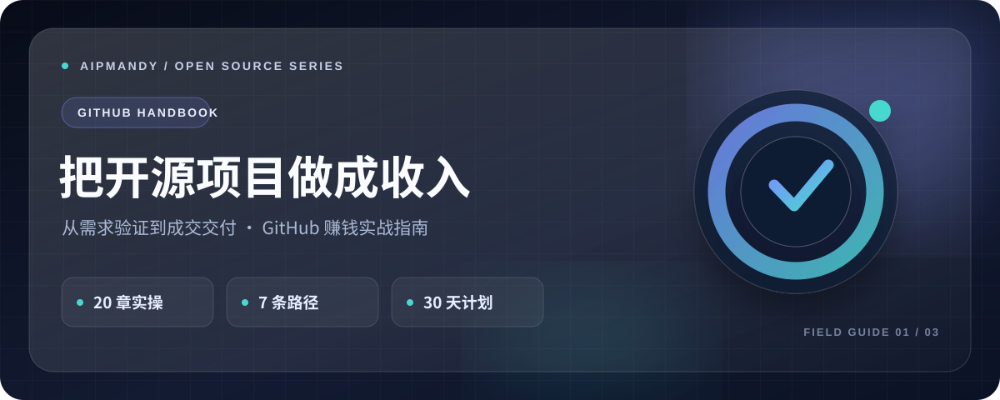

<div align="center">

<a href="https://github.com/AIPMAndy/github-income-handbook"></a>

<h1>GitHub 赚钱实战指南</h1>
<p><strong>把开源作品做成真实的商业机会</strong></p>
<p>20 章实操 · 7 条路径 · 30 天行动计划</p>

<p>
<a href="https://github.com/AIPMAndy/github-income-handbook/stargazers"></a>
<a href="LICENSE"></a>
<a href="https://github.com/AIPMAndy/github-income-handbook/actions/workflows/pages.yml"></a>
</p>
<p><strong><a href="https://aipmandy.github.io/github-income-handbook/">📖 在线网站</a> · <a href="templates/30-day-checklist.md">🗺️ 30 天计划</a> · <a href="templates/metrics.csv">📊 漏斗看板</a></strong></p>

<p><a href="https://github.com/AIPMAndy/github-income-handbook">GitHub 赚钱</a>　·　<a href="https://github.com/AIPMAndy/x-income-handbook">X 赚钱</a>　·　<a href="https://github.com/AIPMAndy/threads-income-handbook">Threads 赚钱</a></p>

<p><sub>AI 酋长 Andy · <a href="https://metaver.vip/">个人官网</a> · <a href="https://metaver.vip/services">咨询与陪跑</a> · 微信：<code>AIPMAndy</code></sub></p>

</div>

## 3 分钟开始

1. **先看路径**：阅读下方「七条路线怎么选」，选一条适合自己能力的商业路径。
2. **直接动手**：下载 [30 天执行清单](templates/30-day-checklist.md) 和 [漏斗看板](templates/metrics.csv)。
3. **验证交付**：用 [在线工具与教程](https://aipmandy.github.io/github-income-handbook/) 梳理需求、线索与收入假设。

## 项目解决什么问题

### 1）内容更硬

这不是一份“GitHub 躺赚教程”。它解决的是更现实的问题：

- 什么样的 GitHub 项目，才有机会带来真实收入；
- 哪些只是流量、关注和自我感动；
- 怎么从**问题验证 → 开源资产 → 线索 → 报价 → 交付 → 复盘**走完一条链路；
- 怎么用**对抗式审核**打掉最容易吹过头、最容易自嗨的部分。

### 2）网站更高级

- 升级为**液态玻璃 / 流动玻璃**视觉风格；
- 更强的层次、光影、卡片质感和滚动氛围；
- 首页直接突出“仓库不是收款码，Star 不是收入”；
- 新增**对抗式审核 / 红队审查**模块，先拆幻觉，再给路径。

### 3）转化结构更清晰

整套项目不靠夸张承诺吸引人，而是靠：

```text
真实问题 → 可验证的开源资产 → 搜索/社区发现 → 有效线索 → 付费产品/服务 → 交付验收 → 复购/口碑
```

**GitHub 通常不是你的收款平台。** 真正值钱的，是你通过公开项目建立的信任，最终有没有被验证成真实交付。

## 你能获得什么

- **20 章可直接执行的教程**：从选题、建库、README、分发、询盘、报价、交付到复盘；
- **7 条商业路径**：咨询、定制部署、模板资源、Sponsors、悬赏、独立 SaaS、作品集机会；
- **30 天执行清单**：把“看懂了”变成“开始做了”；
- **收入假设计算器**：逼你算净额，不算幻觉；
- **对抗式审核模块**：专门拆错觉、拆伪需求、拆假增长；
- **液态玻璃风网站**：适合直接做 GitHub Pages 展示站；
- **14 份模板**：问题验证、服务报价、需求访谈、客户验收、内容发布、指标复盘等。

> ⚠️ 本项目分享方法，不保证收益。所有计算器结果仅为假设演算，不代表实际收入、投资收益或平台承诺。

## 七条路线怎么选

| 路线 | 适合谁 | 付费交付 | 一票否决项 |
| --- | --- | --- | --- |
| 开源获客 → 咨询/培训 | 有实战经验的顾问、老师、操盘手 | 诊断、辅导、培训 | 没有具体问题可解决 |
| 工具开源 → 定制部署 | 开发者与 AI 集成人员 | 部署、迁移、维护 | 没有交付能力 |
| 模板资源 → 数字产品 | 能沉淀 SOP/模板的人 | 专业工具包、授权 | 授权不清晰 |
| GitHub Sponsors | 持续维护项目的人 | 社区赞助 | 地区/合规资格不符 |
| 任务悬赏 → PR | 具备任务交付能力的开发者 | 验收的贡献/Issue | 资金来源与条款不明 |
| 开源产品 → 独立 SaaS | 有产品与工程能力 | 独立托管、支持 | 无留存及运维预算 |
| 教程/作品集 → 职业机会 | 擅长教学与公开展示的人 | 培训、写作、就业 | 成果无法验证 |

## 整套教程最核心的一句话

**仓库不是收款码。**

别人愿不愿意付钱，不取决于你有没有开源，而取决于：

1. 你解决的是不是真问题；
2. 你的项目能不能证明你真有能力；
3. 有没有正确的人发现它；
4. 你能不能给出清晰的付费交付。

## 新增：对抗式审核 / 红队审查

为了避免这类项目越做越虚，本仓库新增了一套红队问题：

- 你验证的是需求，还是自己的兴趣？
- 你拿到的是流量，还是愿意沟通的人？
- 你展示的是能力，还是在堆功能？
- 你卖的是结果，还是模糊承诺？
- 你算的是营收，还是算了真正到手的钱？
- 你是在建立资产，还是制造一次性内容垃圾？

这部分会直接体现在首页模块和章节逻辑里。

## 项目目录

```text
.
├── index.html                # 高级液态玻璃风学习站 / 工具
├── assets/                   # CSS、JS、封面图与图标
├── data/                     # 课程目录与路线数据
├── chapters/                 # 20 章教程
├── playbooks/                # 8 篇详细按键实操手册
├── templates/                # 可复制表单、话术、提示词和数据看板
├── research/                 # 来源、案例证据、合规清单
├── .github/workflows/        # CI + GitHub Pages 自动部署
└── scripts/check.py          # 发布前基础审计
```

## 发布与运行

1. 克隆或下载仓库；双击根目录 `index.html` 可直接浏览，无需 npm；
2. 发布 GitHub Pages：**Settings → Pages → Source: GitHub Actions**；
3. 若要接咨询转化，请把官网和服务说明放在独立域名；
4. 修改微信 / 官网，在 `assets/app.js` 的 `PUBLIC_CONTACT` 常量中更新；
5. 运行 `python3 scripts/check.py` 做基础自检，`node --check assets/app.js` 做语法检查。

## 作者本人项目：事实与假设

- [FreeToken](https://github.com/AIPMAndy/FreeToken)：作者自述已有百度、Bing 搜索用户进入。**可判断**：搜索发现信号已出现；**不可直接判断**：已有 GitHub 变现收入。
- [GoodPaper](https://github.com/AIPMAndy/GoodPaper)：解决论文格式重复劳动。**待验证**：不同用户是否有持续愿付费的需求。
- [HowToBeAnAICreator](https://github.com/AIPMAndy/HowToBeAnAICreator)：公开 AI 博主方法教程。可作为专业能力展示，但不能自动等于收入。

## 联系

官网：**https://metaver.vip/**  
服务：**https://metaver.vip/services**  
微信：**AIPMAndy**（请主动搜索，备注“GitHub 赚钱攻略”）

欢迎通过 GitHub Issue 报告事实错误、过时规则或教程步骤不可用。越经得起对抗式审核，这个项目就越值钱。
